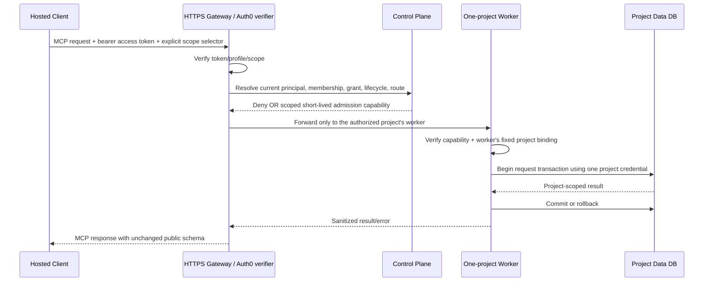

# Hosted Control-Plane/Data-Plane Architecture

**Status: PROPOSAL — NOT APPROVED.** This document evaluates an ACL-independent
cross-project data-plane boundary for hosted Celestin. It does not assert that
Neon lacks a capability, prove PostgreSQL behavior, approve a provider, enable
hosted service, or authorize a database operation. “ACL-independent” here means
that cross-project data isolation does not depend on revoking PostgreSQL's
built-in advisory-lock function privileges. Database connectivity, role, and
`CONNECT` privileges are still required and must be verified.

## Decision summary

**Conditional recommendation for review:** use a central control plane for
identity, membership, project lifecycle, routing metadata, and provisioning
state, paired with one data database per project and a project-isolated runtime
service that holds credentials for that one database only. The public hosted
gateway should hold no project data credentials. Keep the project database
credential, worker deployment, database identity, and secret reference bound to
one immutable project scope.

This is a proposed architecture, not an accepted decision. It provides the
clearest boundary against a project credential or project worker interfering
with another project's data database, without relying on global advisory-lock
ACL operations. It does not contain compromise of a central authorization
service that can authorize all projects, a provider/database administrator, or
a deployment system that can distribute all project credentials. It also does
not eliminate same-project SQL or lock interference. Product/security,
storage/database, operations, and provider owners must approve the model and
its residual risks before implementation.

This is a conditional candidate recommendation for owner review; it does not
change the **blocked / no architecture approved** status recorded in the
[existing decision matrix](hosted-isolation-architecture-decision-matrix.md).

The existing hosted runtime remains gated by its current fail-closed readiness
checks. Do not remove `_UNVERIFIED_LOCK_KEY_SCOPE_SIGNATURES`, loosen the
current readiness profile, or treat this proposal as evidence to enable hosted
multi-tenant serving. Local stdio and SQLite remain separate and unchanged.

## 1. Verified current repository behavior

| Area | Verified source behavior | Limit |
|---|---|---|
| Local runtime | `celestin`, `orbit`, and `memory-bridge` use the local stdio/SQLite path; `celestin-hosted` is a separate Streamable HTTP entry point. See [README](../README.md), [migration guide](postgres-migrations.md), and `src/orbit/mcp_server/server.py::main`. | This design makes no local runtime change. |
| Hosted routing | `HostedRuntimeSettings` has one authorization DSN and a mapping of `(workspace_id, project_id)` to project-DSN environment-variable names. `_create_pools` builds one control pool and a bounded mapping of project pools in the hosted process. `HostedDatabasePools.project_connection` accepts a resolver-issued `ResolvedProjectScope`, performs exact-pair lookup, and has no shared-pool fallback (`src/orbit/mcp_server/hosted_server.py`). | The checked-in source does not prove each DSN is a physically separate database, nor does it isolate project credentials into separate processes. One process can hold multiple configured project pools. |
| Hosted request authorization | `ProjectScopedPostgresHostedAuthorizationSessionFactory._execute_authorized_request` performs a control-plane routing authorization, closes that transaction, selects the exact configured project pool, then repeats authorization inside the project transaction before binding the handler (`src/orbit/postgres/authorization.py`). | The route result is not final authority, but control-plane/data-plane revocation is currently a same-architecture transaction protocol. It cannot be assumed atomic after moving data into separate databases. |
| Request UoW | `PostgresRequestUnitOfWork._bind` constructs memory, retrieval, and Evidence adapters over one authorized request connection (`src/orbit/postgres/unit_of_work.py`). | The UoW is not an isolated service boundary against hostile same-process code; its docstring explicitly treats Python in-process code as trusted. |
| Project scope and RLS | Migrations 0008–0009 map `session_user` to protected project scope and apply forced RLS; readiness inspects role, function, policy, and trigger profiles (`src/orbit/postgres/migrations/0008_project_scoped_runtime_roles.sql`, `0009_advisory_lock_scope_hardening.sql`, `src/orbit/mcp_server/hosted_server.py`). | Current function/ACL and reader/admin scope checks remain fail-closed. Source fixtures are not evidence of actual database catalog state. |
| Lock use | The migration runner uses session `pg_advisory_lock(bigint)` / unlock; request and authorization paths use transaction advisory-lock helpers from migrations 0008–0009 (`src/orbit/postgres/migrations/runner.py::_lock`, `::_unlock`; `src/orbit/postgres/authorization_locking.py`). | Direct advisory-lock interference and provider ACL/ownership behavior have not been live-verified. Separate databases would contain data-plane lock interference to one project database, but not remove same-database interference. |
| Timeouts | `PostgresHostedAuthorizationSessionFactory._transaction` applies transaction-local `statement_timeout` when configured. Hosted settings define pool, connection, and statement timeouts (`src/orbit/postgres/authorization.py`, `src/orbit/mcp_server/hosted_server.py::HostedRuntimeSettings`). | No explicit lock timeout, idle-in-transaction timeout, whole-request deadline, or isolation-level contract is established by this code. |
| Provisioning readiness | `assess_hosted_onboarding` assesses caller-supplied evidence offline and always reports `live_database_verified=false`, `service_permitted=false`, and `provisioning_permitted=false` (`src/orbit/mcp_server/hosted_preflight.py`). | It cannot attest that evidence came from the claimed database, establish provider capabilities, or provision roles/databases. A privileged operator workflow is not implied by the assessment API. |
| Existing offline routing tests | `tests/test_hosted_server.py::test_project_pool_selection_requires_exact_resolver_scope_and_never_falls_back` and `tests/postgres/test_request_unit_of_work.py::test_project_pool_is_never_selected_after_preliminary_denial` cover exact-scope routing and denial before project-pool selection with test doubles. | These tests do not prove physical database separation, credentials, RLS, advisory behavior, or live authorization. No new test was added because the current offline no-fallback behavior already has focused coverage and the proposed architecture is not implemented. |

The repository's current migrations package combines identity/authorization
objects and project content/storage objects; it does not establish separate
control-plane and per-project migration sets. Do not reuse migrations 0001–0009
unchanged as a proven database-per-project layout. Any split or per-project
bootstrap design requires a reviewed forward migration and migration plan.

## 2. Threat model and boundary goals

The design should preserve the existing distinction between application
authorization and database isolation:

| Threat | Proposed control | Residual risk / evidence still needed |
|---|---|---|
| Unauthenticated HTTP caller | Authenticate at the hosted gateway; reject before project routing or a worker call. | Auth0 tenant, API audience, token configuration, transport, and live tests remain deployment prerequisites. |
| Authenticated principal without workspace/project/action access | Resolve the verified `(issuer, subject)` against current control-plane membership/grants; require an explicit workspace selector; issue no project capability on denial. | Application bugs and stale control-plane state remain risks. Negative authorization must be tested at the gateway and worker boundary. |
| Query bug omits tenant predicate | A per-project database contains only that project's content; retain project scope checks and database constraints/RLS as defense in depth. | RLS definitions, user/role mappings, and actual project-to-database assignment need live validation. A single database with RLS remains the current design, not this proposed boundary. |
| Arbitrary SQL under a project runtime credential | Give that credential access only to its assigned project database and minimum project-local objects. | It may still read/change anything allowed within its own project DB, consume resources, and take locks there. Database separation does not neutralize a compromised project credential. |
| Project worker/process compromise | Run one project scope per worker/service identity, with one project data credential injected only into that worker. | A platform operator or deployment system able to inject every credential can still cross project boundaries. Compromise of a shared gateway/control-plane signer may mint authorization for any project. |
| Compromised gateway/control plane | Keep data credentials out of the gateway; require project worker to verify a narrowly scoped, short-lived internal authorization capability and its own configured project binding. | If the control-plane signing authority or authorization database is compromised, an attacker may authorize access across projects. Eliminating that central trust requires a stronger separately approved trust/key model. |
| Advisory-lock interference | Project databases create separate data-plane lock domains; a project login cannot contend on another database's locks if it cannot connect there. | Same-project runtime can still interfere with project-local locks. The central control-plane database remains a global availability boundary; its request path must not rely on untrusted arbitrary advisory keys. Verify actual server behavior and roles. |
| Stale routing, pool reuse, or credential rotation | Route only after current authorization; bind each worker and pool to one immutable project/database identity; reject unknown, stale, or mismatched route versions; never fall back. Drain old workers/pools before revoking old credentials. | Lease format, freshness, route-version lifecycle, and rotation protocol are not implemented or approved. Test them against a disposable environment. |
| Migration/provisioning failure | Keep migration/provisioning identities out of request workers; use an explicit per-database operator workflow, ledger, preflight, and recovery record. | Existing runner's advisory-lock coordination can still be interfered with inside that database. A protected coordinator and bootstrap single-writer protocol need design and live tests. |

### Confidentiality/integrity versus availability

With properly distinct credentials and connection boundaries, project A's data
credential should not authenticate to project B's database; this is the
intended confidentiality/integrity boundary to prove. Advisory-lock calls do
not by themselves grant access to another database's rows, but lock contention
can impair availability. Under this architecture, a project runtime's direct
advisory calls should be contained to its own project database. A compromised
control-plane service, provider administrator, or process holding multiple
project credentials remains a broader trust failure. Database-local advisory
lock behavior is the expected PostgreSQL model, but it has not been verified
against the selected hosted provider/configuration and remains a live-test
acceptance item.

## 3. Architecture alternatives

All alternatives must keep local SQLite/stdio as a separate runtime and must
keep MCP request/response schemas stable unless separately approved.

### A. Shared PostgreSQL database with row-lock-based authorization coordination

- **Confidentiality/integrity:** RLS, trusted `session_user` scope, and
  application authorization remain essential. Row-lock coordination can
  serialize authorization changes but does not itself replace tenant filtering
  or prevent a compromised shared app process from using all its credentials.
- **Availability:** replacing Celestin advisory coordination with row locks
  avoids using advisory lock keys for those paths, but a credential with
  built-in advisory execution can still interfere with other advisory users in
  the shared database, including a runner that retains that design. This does
  not meet a no-cross-project-lock-interference goal by itself.
- **Revocation:** can be correct only if every request and every relevant
  identity, membership, grant, lifecycle, mapping, trigger, and provisioning
  writer locks the same authoritative rows/anchors in a consistent order and
  rechecks after waiting under an approved snapshot policy. The full protocol
  is not implemented or live-tested.
- **Privileges/provider:** requires ordinary row privileges and RLS support;
  no global advisory ACL change is required for row-based request
  authorization, but the current migration runner still uses advisory locks
  until redesigned. Row-lock permissions and forced-RLS behavior must be
  tested on the target provider.
- **Operations/cost/recovery:** one DB and current pool model are simpler, but
  shared schema changes, tenant-wide backup/restore, noisy-neighbor effects,
  and one database's availability remain common concerns. This is the lowest
  database-count option; no cost estimate is asserted.
- **Tests:** exercise both request-first and revoke-first races, every write
  path, absent-row anchors, deadlock order, timeout/cancel/rollback, RLS, and
  arbitrary advisory lock interference. These must be live tests, not just fake
  transaction tests.

### B. Central control plane plus one data database per project, with a
multi-project application process holding multiple credentials

- **Confidentiality/integrity:** distinct DB credentials can prevent a single
  project login from connecting to another project database. However, the
  shared application process can use any credential it holds; a process
  compromise can cross projects. This is not sufficient for the stated
  compromised-process threat.
- **Availability:** data-plane advisory contention is database-local, but a
  process with all DB credentials can still deliberately consume or lock every
  tenant database. Control-plane availability is shared.
- **Revocation:** control-plane and data-plane work are not one atomic
  transaction. Revocation needs a lease/fencing or synchronous authorization
  protocol, drain/reconciliation semantics, and fail-closed routing.
- **Privileges/provider:** requires database creation, independent login
  credentials, restricted `CONNECT`, secret management, and controlled
  routing. These provider capabilities and limits are unverified. This option
  is an improvement in credential blast radius only if credentials are not
  co-resident in a compromised process.
- **Operations/cost/recovery:** one DB per project multiplies database,
  migration, backup, pool, monitoring, and credential lifecycle work. No
  pricing or scale numbers are established. Migration fan-out and partial
  failure recovery become necessary.
- **Tests:** prove project credential A cannot connect to database B, then
  separately prove that the multi-project process compromise remains a known
  residual. Test central revocation propagation and partial failure.

### C. Central control plane plus one data database and isolated runtime
service/credential per project — **conditional recommendation**

- **Confidentiality/integrity:** each project worker has one configured
  project ID and one data credential; the gateway/control plane has no project
  data credentials. A compromised worker/credential is bounded to that
  project's database, assuming provider connection grants and secret injection
  are correct. Control-plane signing, deployment, and provider administrators
  remain trusted.
- **Availability:** project A's data-plane lock contention is bounded to A's
  database. This avoids relying on global advisory-function ACL changes for
  cross-project data isolation. Arbitrary lock use can still delay A's own
  operations or migration. The control-plane DB remains a shared availability
  dependency and must have a separately reviewed coordination strategy.
- **Revocation:** the control plane and project database cannot commit one
  cross-database transaction. A proposed admission-lease and drain protocol is
  specified below; product/security must decide whether bounded in-flight work
  may complete. Immediate cancellation is not claimed.
- **Privileges/provider:** requires per-project database provisioning,
  distinct login/credential, restricted connection rights, secret-store
  references, and worker isolation. It does **not** require built-in advisory
  ACL changes to isolate data locks across projects. Those database and
  operational capabilities are not verified for Neon.
- **Operations/cost/recovery:** strongest fit to the cross-project
  credential/lock threat but highest operational complexity among these
  options: service/database inventory, deployment isolation, secret rotation,
  per-project migration state, backups/restores, monitoring, capacity limits,
  and deletion lifecycle. Cost drivers are database/service count, retained
  backups, compute, connections, and operator effort; no prices or capacity
  assumptions are provided.
- **Tests:** validate credential and network isolation, one-project worker
  binding, no fallback, lease/revocation races, independent failure domains,
  per-project migration recovery, and same-project lock/availability limits on
  live disposable databases.

### D. Move to a PostgreSQL host/configuration with the required administrative
capabilities

- **Confidentiality/integrity:** a different host alone provides no isolation
  protocol. It may allow the existing shared-database design to enforce exact
  role, RLS, function owner, and advisory ACL rules if those capabilities are
  authoritatively documented and tested.
- **Availability:** direct advisory interference remains if relevant function
  execution is still available; a provider switch does not establish lock
  scope, request bounds, or revocation order.
- **Revocation:** still requires the same transaction, lock ordering, and
  fresh-authorization semantics as the chosen shared-database design.
- **Privileges/provider:** depends on the selected provider/version, exact
  role attributes, object ownership, ACL grantability, and migration recovery.
  No generic PostgreSQL behavior is evidence of Neon support, and no alternate
  host is evaluated or selected here.
- **Operations/cost/recovery:** a provider move can add migration, data
  residency, network, backup, incident response, and operational costs. No
  provider-specific prices or guarantees are asserted.
- **Tests:** repeat the complete catalog, RLS, role-switching, direct-lock,
  revocation, pool-reset, failure, and migration suite on an approved disposable
  target before any hosted release.

### Comparative conclusion

Under the threat that one project's arbitrary SQL credential must not interfere
with another project's data-plane locks, C is the strongest candidate because
it combines physical database boundaries with credential/process boundaries.
B lacks process compromise containment; A leaves a shared lock namespace and
shared role/security boundary; D is an environment choice rather than an
isolation design. C is a **conditional proposal**, not a selected or approved
architecture. If product/security does not accept per-project service and
database operations, or the storage/provider owner cannot establish the
required database and credential isolation, the hosted architecture remains
blocked. Do not use RLS alone to claim resistance to arbitrary advisory-lock
interference.

## 4. Proposed request routing and authorization boundary

The following is a design proposal, not current runtime behavior:

1. The HTTPS gateway validates an Auth0 access token and required API scope.
   Request workspace/project values remain resource selectors, never identity
   or authorization proof.
2. The control plane resolves the verified `(issuer, subject)`, active
   principal, workspace membership, project lifecycle, and requested action
   against current control-plane state. Missing workspace, unknown route,
   inactive principal, or denied action returns a non-sensitive denial before
   a project worker is selected.
3. The control plane issues an internal, short-lived, project/action-scoped
   admission capability to the worker assigned to that project. Its issuer,
   audience, subject, workspace/project binding, action, expiry, and
   revocation/version behavior must be specified and approved. The worker also
   checks the project ID/database identity it was provisioned for. Caller
   headers, custom PostgreSQL GUCs, arbitrary lock keys, and stale route data
   cannot override those bindings.
4. A gateway sends the request only to the worker for that authorized project.
   The gateway has no project database credentials. An unknown or unavailable
   worker is a denial/unavailable response; there is no shared credential or
   default-database fallback.
5. The worker checks the capability against its configured project, obtains
   only that project's database credential, runs the protected operation in
   one request transaction/UoW, and records completion only after commit or
   rollback. Pool reuse stays inside that worker/project identity. The worker
   cannot choose another project pool from request data.
6. If authorization state, route version, credential version, or worker health
   is stale or inconsistent, fail closed. Reconfiguration drains and closes
   old pools before old credentials are revoked; no stale process may retain a
   usable old credential after rotation completes.



`ProjectScopedPostgresHostedAuthorizationSessionFactory` is a current local
integration point for route selection and final authorization, but it currently
does both within one process and configured connection set. A future gateway,
capability verifier, worker boundary, and control-plane/data-plane store split
must be separately designed; this diagram is not evidence that those pieces
exist.

## 5. Proposed revocation ordering — not approved

Separate databases remove cross-database atomicity. The existing documented
same-database “revocation waits for an in-flight request” behavior cannot be
assumed to carry over unchanged. Product/security must choose and approve the
semantics before implementation.

### Candidate bounded-drain policy

**Proposal:** revocation immediately stops *new authorization admissions* at a
control-plane linearization point, while requests admitted before that point may
finish within a bounded in-flight window. Mark the principal/grant `REVOKING`
in the control-plane transaction that serializes capability issuance. Do not
mark it `REVOKED` until all admitted operation leases have completed or have
been proven expired and their data transactions have ended. The successful
commit to `REVOKED` is the final revocation point. This policy is not immediate
cancellation of work already admitted.

For this proposal to be meaningful, future implementation must define all of
these together:

- Capability/lease identity and exact binding to principal, workspace,
  project, action, worker audience, and route/credential version.
- Whether lease issuance and setting `REVOKING` serialize on a control-plane
  row/anchor; the lock order and recheck point; isolation and stale-snapshot
  handling. This proposes transactional row coordination rather than
  arbitrary advisory keys, but does not claim source or live proof.
- How an admitted operation becomes visible as in flight, how commit/rollback
  is reported, how a crashed worker is fenced, and how a lease timeout relates
  to the maximum database transaction/request duration.
- What happens if the control plane is unreachable, a worker is partitioned,
  the completion report is lost, or a data commit outcome is uncertain. If
  active work cannot be proven finished, remain `REVOKING`; do not silently
  report final revocation.
- Lock-wait, statement, idle-transaction, whole-request, and capability-expiry
  limits. Values must come from approved service objectives; none are set here.
- Whether requests admitted before revocation may begin the data transaction
  later, and whether the worker must make a final online authorization check
  immediately before protected work. These are not interchangeable semantics.

```text
Request admission (proposal):
  verify Auth0 token
  begin control-plane transaction
  lock/read authoritative project-grant anchor in approved order
  recheck principal + membership + project lifecycle + action grant
  if state != ACTIVE: deny
  create bounded operation lease and bind current route/credential version
  commit admission transaction
  send capability only to its fixed project worker
  worker verifies audience, scope, version, expiry and local project binding
  begin one project-data transaction; enforce approved deadlines
  perform operation; commit/rollback; report lease completion

Revocation (proposal):
  authenticate authorized administrator
  begin control-plane transaction
  take the same grant/admission coordination boundary
  recheck administrator authority and target grant
  set REVOKING; prevent new lease issuance; commit (admission cutoff)
  wait for admitted operations to commit/rollback or for an approved
    fencing/expiry protocol to prove that no data transaction can continue
  if completion cannot be established: remain REVOKING and alert operators
  otherwise begin control-plane transaction, recheck state, set REVOKED,
    write audit event, commit (final revocation point)

Request after admission cutoff: no new lease; deny before data-pool selection.
Request with earlier lease: behavior depends on the approved lease policy;
  it may finish only within the approved bound, or must be canceled/fenced.
```

This proposal does **not** promise immediate revocation at the `REVOKING`
commit. It proposes that new admissions stop there, and final `REVOKED` state
waits for admitted work to drain. A ticket that can be used after the cutoff
without an active-lease/fencing mechanism weakens that statement. Implementers
must not treat a signed token's expiry alone as proof that an already-open data
transaction has ended.

On timeout/cancellation before data commit, the worker rolls back, closes or
resets its connection, and only then reports completion. On connection loss
during commit, the outcome is uncertain; the lease remains unresolved until a
fresh authorized reconciliation. No automatic protected-write retry is implied
here; delivery/replay semantics remain outside this design and governed by the
separate D-08 decision.

## 6. Provisioning, migrations, and recovery

**Proposed onboarding sequence:**

1. Validate an administrator-authorized onboarding request and establish a
   unique immutable project-to-database/worker route in the control plane.
2. Create the project database and its restricted login through an explicit
   privileged operator workflow. Store only a secret-manager reference in
   control-plane metadata; never put credential values in routing records,
   logs, or diagnostics.
3. Apply a reviewed project-data migration set through a separate
   migration-executor identity. Run preflight and verify database identity,
   role attributes, ownership, grants, RLS, migration ledger, and recovery
   state. Normal MCP startup and requests never provision roles or migrate.
4. Start the one-project worker with exactly one project credential. Verify
   its configured project identity and restricted DB connection, then mark
   the route ready. Do not route traffic before this transition.
5. Reconcile failed/partial provisioning explicitly. Unknown or contradictory
   state remains blocked; retries must be idempotent at each named stage and
   require an operator-safe recovery protocol.

Existing migrations 0001–0009 are not edited by this proposal and should not
be copied unchanged into a per-project layout without classifying every object
as control-plane or project-data state. Design separate versioned migration
sets or a reviewed split; record checksums and state per database. A fleet-wide
upgrade is not atomic: use compatible expand/contract stages, per-project
health gates, resumable progress, backups, and an explicit policy for tenants
that lag or fail.

### Migration coordination and advisory locks

The current runner uses `pg_advisory_lock(bigint)` on the database it migrates.
Per-project databases make one project's advisory-lock interference unable to
target another project's database, assuming the connection grants enforce
that boundary. They do not protect the same database's migration lock from a
project runtime that can issue the same built-in lock call.

**Proposed follow-up:** evaluate a migration coordination row/table protected
from project runtime roles and lock it only through the migration identity.
For an existing database, this could serialize operators after the protected
object exists. Fresh bootstrap has no coordination row yet and must be
single-writer under an explicit provisioning lease or another independently
protected coordinator. Do not create that table or change the runner in this
task. An external control-plane lease also needs fencing and crash recovery so
loss of the coordinator connection cannot permit overlapping data migrations.

Do not revoke all advisory-lock built-in privileges merely to claim
cross-project isolation. Keep the current shared-database hosted readiness gate
closed until its own reviewed profile passes; a per-project architecture needs
its own readiness contract and live evidence, not a flag change. If Neon cannot
provide required database/role/connection boundaries, investigate an
authoritatively verified host or keep hosted service disabled. No provider
capability is asserted here.

**Proposed rotation/deletion lifecycle:** stop new admission, drain/fence
requests, deploy the replacement worker credential, verify it, close old pools,
then revoke the old credential; retain an auditable route/credential version
without storing secret values. For project deletion, stop admission and drain
workers before applying an owner-approved retention/backup/delete policy.
Database deletion is destructive and is not authorized by this document.
Partial failure leaves an explicit blocked lifecycle state for operator
reconciliation rather than silently reusing stale credentials.

## 7. Cost and operational drivers

No prices, provider quotas, or performance numbers are established. Compare
options using measured or provider-confirmed values for:

- Database count and compute/retention/backup billing.
- Worker/service count and deployment/monitoring overhead.
- Connections and pool capacity per project, including idle tenants.
- Migration fan-out duration, failed-tenant lag, and recovery labor.
- Credential creation, storage, rotation, emergency revoke, and stale-pool
  drain.
- Backup/restore and deletion lifecycle per project.
- Control-plane availability, capability issuance latency, and reconciliation.

Do not scale by reverting to a shared data credential without a separate
security decision and threat-model review.

## 8. Decisions and evidence still required

| Owner role (not an assigned person) | Decision/evidence required | Blocks |
|---|---|---|
| Product/security | Accept or reject the per-project DB plus one-project worker boundary; identify which compromise scenarios must be contained and which remain trusted. | Architecture approval and hosted design. |
| Product/security | Choose immediate cancellation versus admission cutoff plus bounded in-flight drain; define exact `REVOKING`/`REVOKED` meaning and client-visible denial behavior. | Lease and authorization protocol. |
| Storage/database | Decide where identity/membership authority lives, whether project workers require online reauthorization or scoped leases, the lease/fencing protocol, and transaction/isolation/timeout rules. | Schema split, transaction design, and race tests. |
| Storage/database | Define per-project database contents, migration set/ledger, protected migration coordinator, fresh-bootstrap serialization, rollback/retry, backup, and restore lifecycle. | Provisioning and migration implementation. |
| Operations/security | Select secret manager, worker deployment isolation, audit/monitoring, route and credential rotation, incident response, and acceptable operational burden. | Safe provisioning and release operation. |
| Provider/database administrator | Supply authoritative evidence for per-project database provisioning, distinct credentials, `CONNECT` restriction, role creation/revocation, TLS, backup/restore, pool limits, database count, migration permissions, and recovery on the intended Neon configuration (or a reviewed alternative). | Provider selection and live test readiness. No Neon claim is currently verified. |
| Product + storage + provider | Separately authorize a fresh, disposable live target and the exact test/migration operation after the design is approved. | Live validation only; architecture agreement does not grant database-operation authorization. |

No named accountable individuals or recorded approvals were found in the
repository materials reviewed. Status is **proposed / unresolved**; no
architecture, provider, or live-test approval is implied.

## 9. Acceptance evidence before hosted enablement

### Offline evidence already present

The current offline suite has tests for exact resolver-scope project-pool
selection, unknown-scope no-fallback, denial before project-pool selection,
request UoW composition, readiness, and migration-runner control flow using
test doubles. These tests verify Python source behavior only. They do not
establish database separation, lease semantics, RLS, grants, or lock behavior.

No additional source tests are added with this design: the existing route
no-fallback and pre-denial tests cover the only current source behavior
relevant to it. A synthetic test of a future worker/lease protocol would encode
an unapproved proposal rather than verify implemented behavior.

### Required future live disposable tests

1. Provision two isolated project databases and distinct restricted logins.
   Verify the project A credential cannot connect to project B's database or
   read/write any of B's data even with arbitrary SQL and forged GUCs.
2. Inspect the live database identity, login attributes, database `CONNECT`
   grants, object ownership, role membership, RLS state, secret references, and
   worker-to-project binding. The control-plane gateway must not have project
   data credentials; compromise of one project worker must reveal only its one
   configured database credential.
3. Take arbitrary advisory locks with project A's login and verify project B's
   requests and migration progress are unaffected. Separately show that
   same-project lock interference is bounded, detected, and documented; do
   not claim it is eliminated.
4. Race admission/capability issuance against revocation in both orders. Verify
   the chosen cutoff, stale capability, worker crash, missing completion,
   lease expiry, control-plane outage, and uncertain commit rules. Do not mark
   final `REVOKED` while an operation can still commit.
5. Verify unknown/mismatched/stale route, database identity, worker, credential
   version, workspace, project, and action are denied before the handler, with
   no shared-database fallback.
6. Test worker pool reuse and credential rotation, ensuring old sessions are
   closed/reset and cannot continue after the approved fence/revocation point.
7. Test provisioning/bootstrap and multi-database migration serialization,
   failure rollback, retry, partial fleet upgrade, backup/restore, and
   operator audit using the approved migration workflow.
8. Verify request timeout, lock wait, idle transaction, cancellation,
   disconnect, connection loss, and cleanup under the selected provider.
9. Re-run local stdio/SQLite compatibility tests separately once authorized;
   no local transport, schema, or database code is changed by this proposal.

All live tests require a specifically approved fresh disposable target and
separate identities. A successful offline test run is not hosted isolation
evidence.

## 10. Implementation sequence after approval

1. **Record decisions:** product/security approves threat boundary and
   revocation policy; storage approves control/data split, worker binding,
   migration strategy, and timeout/isolation semantics; provider/operations
   provide capability and cost evidence.
2. **Specify state and interfaces:** define control-plane route/provisioning
   lifecycle, credential references, worker registration, admission lease,
   revocation drain/fencing, and sanitized errors. Keep MCP public schemas
   unchanged.
3. **Design migration sets:** inventory 0001–0009 object ownership; define
   separate control-plane and project-data migrations, protected migration
   coordinator/bootstrap, checksums, resumability, and rollback/recovery.
4. **Build offline provisioning/readiness contracts:** explicit blocked states,
   no secret output, no auto-repair, and independent request readiness versus
   privileged preflight.
5. **Implement project provisioning:** operator-only DB/login creation,
   secret reference, restricted grants, schema bootstrap, and audit events.
6. **Implement isolated worker and routing:** one project per worker and
   credential; gateway has no project DB credentials; fail-closed route and
   lifecycle checks.
7. **Implement and verify revocation coordination:** with transaction ordering,
   lease or approved alternative, fencing, deadlines, and recovery before
   enabling protected requests.
8. **Run guarded live security tests:** only after explicit approval of an
   identified disposable target; inspect identity before migration or SQL.
9. **Security review and staged release:** non-production first, evidence
   review, limited exposure, explicit human release approval. Never deploy or
   enable hosted mode automatically.

## 11. Scope boundaries

- **In scope for this design:** hosted control/data trust boundaries, project
  routing, credential/process isolation, revocation questions, migration and
  recovery requirements, provider dependencies, and future acceptance tests.
- **Unchanged:** local stdio/SQLite; public MCP request/response schemas;
  existing migrations 0001–0009; current source-level fail-closed gates.
- **Not authorized or decided:** migration 0010 or any other migration;
  database/schema/role/ACL/credential changes; external provider operation;
  hosted enablement; project data deletion; Auth0 configuration; delivery
  equality/receipts/replay and candidate-revision equality under D-08.

## References

- [Hosted authorization and revocation protocol](hosted-authorization-protocol.md)
- [Hosted lock isolation decision](hosted-lock-isolation-decision.md)
- [Hosted lock isolation test matrix](hosted-lock-isolation-test-matrix.md)
- [Hosted isolation architecture decision matrix](hosted-isolation-architecture-decision-matrix.md)
- [Hosted provisioning readiness](hosted-provisioning-readiness.md)
- [PostgreSQL integration test safety](postgres-integration-tests.md)
- [PostgreSQL migration guide](postgres-migrations.md)
- [Celestin hosted identity and scope contract](hosted-identity-scope.md)
